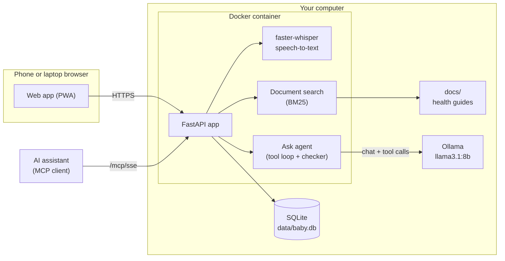
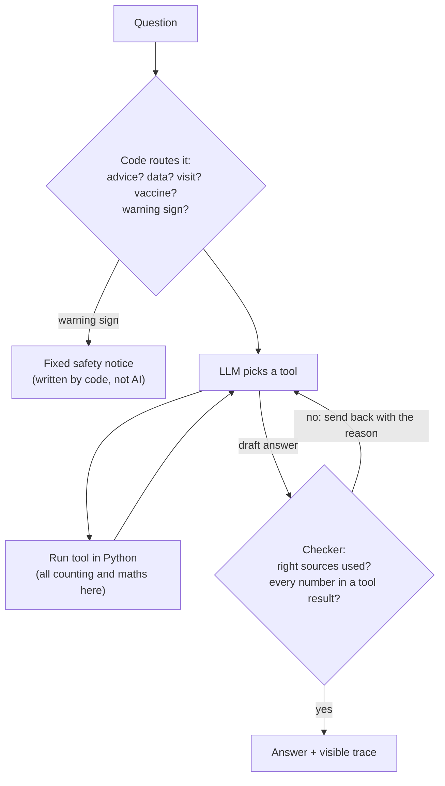

# Baby Companion

**A private, self-hosted baby tracker with local AI.** Log feeds, diapers, sleep and weight by tapping or by voice, record clinic visits and get the notes, and ask questions answered from your own logs and your trusted health guides. Everything runs on your own computer: no accounts, no cloud, no subscription.

Free and open source under the [MIT license](LICENSE). Status: **MVP**, in daily use by one family and ready for others to try and improve.

> **⚠️ Not medical advice.** Baby Companion is a note-taking and information tool, not a medical device. AI answers can be wrong. If you are worried about your baby, call your local health advice line (in Alberta, Health Link **811**) or your doctor. In an emergency, call **911** or your local emergency number.

---

## Why Baby Companion?

Most baby apps keep your child's data on their servers and put the "smart" features behind a subscription. Baby Companion takes a different approach:

| | Typical baby-tracking apps | Baby Companion |
|---|---|---|
| Where your data lives | The company's cloud | A SQLite file on your own computer |
| Account needed | Usually | No |
| AI features | Cloud AI, often paid | **Local AI** (Ollama + Whisper). Nothing leaves your machine |
| Health answers | General knowledge | **Grounded in documents you choose**, with page citations |
| Can you see how the AI decided? | No | Yes: every agent step is shown, and code checks every answer |
| Price | Free tier + subscription | Free, open source |

**Good fit:** privacy-minded parents who are comfortable running a command or two, and developers who want a real-world local-AI project to build on.

---

## Features

**Logging**
- One-tap logging: breast milk / formula feeds (with timer, amount, duration, formula brand), wet and dirty diapers, sleep start/end with timer, weight.
- **Voice Log:** tap, say *"She had 3 ounces of Enfamil and a wet diaper"*, tap again. Two entries are logged. Works on iPhone and Android browsers.
- **Activity** feed of everything logged, shown in your chosen time zone.
- **Installs on your phone** like an app (PWA): add it to the iPhone or Android home screen. See [Using it on your phone](#using-it-on-your-phone-install-as-an-app).

**Clinic visits**
- **Record a visit** (or upload a voice memo). It is transcribed locally and turned into structured notes: summary, weight, length, feeding plan, medications, warning signs, next visit.
- Later, ask *"What did the doctor say about the rash?"*

**Ask Baby Companion (AI agent)**
- Ask anything about your baby's logs, visits, vaccines or your documents: *"Is she eating less this week than last week?"*, *"Enough wet diapers? What do the docs say?"*
- Watch the agent work: each tool it calls, each result, and each automatic check.
- Answers cite your documents as *(document, p. N)*. A red safety notice appears automatically when a question mentions a newborn warning sign.

**Documents**
- Upload PDF, TXT or Markdown health guides (for example your public health authority's newborn guide). They are searched locally to ground every health answer.

**Baby profile and vaccines**
- Birth date and time, birth weight, length, head size, and free-text notes (blood type, allergies, hospital…). The app shows the baby's age and the AI uses it.
- **Vaccine record:** name, date, where it was given, notes, next dose due.
- **Growth percentiles:** ask *"What percentile is her weight?"* and get WHO growth chart percentiles for every weight, length and head measurement (birth, home scale, clinic visits), plus weight change in % of birth weight. The WHO tables ship with the app (`app/services/who_growth.json`) and the maths is done in code, not by the AI. Set the baby's sex on the Baby tab first.

**Next feed and iPhone alarm**
- Shows when the next feed is due based on the last feed (every 2–4 h).
- **One tap sets a real iPhone Clock alarm** through Apple Shortcuts, so it rings on silent and when the phone is locked.

**Insights and briefs**
- Today summary, simple pattern flags (for example fewer than 6 wet diapers in 24 h), a partner **shift handoff**, and a **health line / clinic brief** (72-hour totals, birth details, vaccines) you can copy for a phone call or appointment.

**Integrations**
- **MCP server** at `/mcp/sse`, so AI assistants that support the Model Context Protocol can read the last 72 hours and log feeds and diapers.

---

## How it works



The web app talks to a FastAPI server in Docker. Speech is transcribed inside the container with faster-whisper. The language model runs in [Ollama](https://ollama.com) on the same computer. Your data stays in `data/baby.db` and your documents in `docs/`, both on your disk.

### How the Ask agent answers a question



---

## Tech stack

| Layer | Technology |
|---|---|
| Backend | Python 3.12, [FastAPI](https://fastapi.tiangolo.com), Uvicorn (HTTPS), SQLAlchemy |
| Database | SQLite (single file, `data/baby.db`) |
| Frontend | One-page HTML + vanilla JavaScript, [Tailwind CSS](https://tailwindcss.com) (bundled locally), installable PWA with service worker |
| Local LLM | [Ollama](https://ollama.com) running **Llama 3.1 8B** (configurable) via its chat + tool-calling API |
| Speech-to-text | [faster-whisper](https://github.com/SYSTRAN/faster-whisper) (Whisper `base`, int8 on CPU), ffmpeg for audio decoding |
| Documents | PyMuPDF for PDF text extraction, BM25 ranking implemented in pure Python |
| AI integration | [Model Context Protocol](https://modelcontextprotocol.io) server (`mcp` Python SDK) |
| Packaging | Docker + Docker Compose |
| Tests | pytest (43 tests: parsers, agent routing and checker, search, API, login) |

## AI concepts used (and where to find them)

| Concept | What it does here | Code |
|---|---|---|
| **AI agent / tool-use loop** | The model decides which tools to call, reads the results and repeats until it can answer (up to 8 steps) | `app/services/agent.py` → `run()` |
| **Function / tool calling** | 10 read-only tools: totals for a period, period comparison, daily breakdown, recent events, weight history, WHO growth percentiles, document search, visit notes, immunizations, calculator | `agent.py` → `TOOLS` |
| **Reflection / verifier step** | Before an answer is shown, code checks that the right sources were used and that every number appears in a tool result; failures go back to the model with the reason | `agent.py` → `check_answer()` |
| **Deterministic routing and guardrails** | Code (not the model) classifies the question (advice / data / visit / vaccine) and shows a fixed safety notice for warning signs | `agent.py` → `required_sources()`, `RED_FLAGS` |
| **RAG (retrieval-augmented generation)** | Health guides are chunked, ranked with BM25 and passed to the model with page numbers for cited answers | `app/services/rag.py`, `/rag/query` |
| **Grounding** | Voice-log amounts, units, brands and durations are parsed by code; LLM tool calls that aren't supported by the spoken words are dropped | `app/services/voice_agent.py` → `ground()` |
| **Structured output (JSON schema)** | Clinic-visit transcripts are turned into a fixed JSON care plan using Ollama's schema-constrained output | `app/main.py` → `PLAN_SCHEMA` |
| **Speech-to-text** | Local Whisper transcription with voice-activity detection and a vocabulary hint | `app/services/audio.py` |
| **Graceful fallbacks** | If the model is down, voice logs use a rule-based parser and document search shows the best passages | `voice_agent.py`, `main.py` |
| **Streaming (Server-Sent Events)** | Agent steps stream to the page as they happen | `/api/agent/ask` |
| **MCP server** | Exposes tools, a resource and a prompt to external AI assistants | `app/services/mcp_server.py` |

---

## Getting started

### Requirements

- **Docker Desktop** (Mac/Windows) or Docker Engine + Compose (Linux)
- **[Ollama](https://ollama.com/download)** installed on the same computer
- About **10 GB** free disk space (8B model ≈ 5 GB, Docker image ≈ 2 GB, speech model ≈ 150 MB)
- **16 GB RAM recommended** for `llama3.1:8b` (it uses about 6 GB only while answering). With 8 GB RAM, use `llama3.2` (faster, less accurate).

Developed and tested on an Apple Silicon Mac (M4, 16 GB). Linux and Windows should work but are not yet tested. Reports are welcome.

### Install

```bash
# 1. Get the code
git clone https://github.com/tamilarasan175/baby-companion.git
cd baby-companion

# 2. Download the AI model (one time, about 5 GB)
ollama pull llama3.1:8b

# 3. Settings: copy the example and set a password if you'll use it outside your home network
cp env.example .env

# 4. Build and start
docker compose up --build -d
```

Open **https://localhost:8443**. Your browser will warn about the certificate: the app uses a self-signed certificate it creates for itself. Choose **Advanced → Proceed** (Chrome) or **Show Details → visit this website** (Safari). After each rebuild you may need to accept it again.

The first voice recording takes a little longer because the speech model (~150 MB) downloads once.

### Add your health documents

Download your public health authority's parenting guides as PDFs (in Alberta, see healthyparentshealthychildren.ca), then either upload them in the **Docs** tab or put them in the `docs/` folder and restart. Scanned PDFs (images of pages) can't be read; the upload will tell you if a file has no text.

### Update

```bash
git pull
docker compose up --build -d
```

Your data in `data/` and documents in `docs/` are kept.

---

## Using it on your phone (install as an app)

Baby Companion is a **PWA** (progressive web app): you open it in the phone's browser and add it to the home screen, and it then opens full-screen like a normal app. There's no App Store download.

**How it works:** the app and the AI run on your computer, and the phone is the screen. So the phone must be able to reach your computer, and **your computer must be on and awake**. (A closed MacBook lid means sleep. Keep it open and plugged in, or use a keep-awake app such as Amphetamine.) Without a connection, the app opens but can't save logs or answer questions.

### Step 1: Choose how your phone connects

Your data is stored and the AI runs only on your computer, whichever option you pick. The options differ in whether the connection from your phone passes through someone else's servers.

| Option | Cloud involved? | Works where | Microphone (voice, clinic) | Address stays the same (for the home-screen icon) |
|---|---|---|---|---|
| **A. Home Wi-Fi** | **None** | At home | Sometimes blocked (self-signed certificate) | Yes, while your computer's IP doesn't change |
| **B. Your own VPN** | **None** | Anywhere | Same as home Wi-Fi | Yes |
| **C. Tailscale** | Coordination only; it **can't read** your data | Anywhere | Yes | Yes |
| **D. Cloudflare tunnel** | **Yes: Cloudflare can see the traffic** | Anywhere | Yes | No, a new link each time |

**A. Home Wi-Fi (cloud-free).** Find your computer's local IP address (Mac: System Settings → Wi-Fi → Details → IP address), then on the phone open `https://<that-ip>:8443` and accept the certificate warning (iPhone: **Show Details → visit this website**).

**B. Your own VPN (cloud-free, more technical).** Many home routers have a built-in WireGuard or OpenVPN server. Connect your phone to your home network through it, then use the home Wi-Fi address from option A. Self-hosting [Headscale](https://github.com/juanfont/headscale) is another option for people who want Tailscale-style convenience without Tailscale's servers.

**C. Tailscale (easiest private access from anywhere).** [Tailscale](https://tailscale.com) links your devices into a private network. Traffic between your phone and computer is end-to-end encrypted; Tailscale's servers help the devices find each other and can relay encrypted traffic, but can't read it. It needs a free Tailscale account.
1. Install Tailscale on your computer and on your phone, and sign in to the same account on both.
2. In the Tailscale admin console, under **DNS**, turn on **MagicDNS** and **HTTPS certificates**.
3. On your computer, run:
   ```bash
   tailscale serve --bg https+insecure://localhost:8443
   ```
   It prints an address like `https://my-mac.tail1234.ts.net`. That address has a real certificate, so the microphone works, and it never changes.
4. Open that address on the phone (with Tailscale switched on).

Check the [Tailscale Serve docs](https://tailscale.com/kb/1312/serve) if the command differs in your version.

**D. Cloudflare quick tunnel (testing only).** Cloudflare decrypts the traffic on its servers before forwarding it to your computer, so your logs, questions and recordings pass through Cloudflare in readable form while the tunnel runs. Use it only to try things out, not for everyday use. **Set `APP_PASSWORD` in `.env` first**: anyone with the link can open the app.
```bash
cloudflared tunnel --url https://localhost:8443 --no-tls-verify
```
Open the `https://….trycloudflare.com` link it prints, and press Ctrl+C to stop. The link changes every time, so a home-screen icon made from it stops working after a restart.

### Step 2: Add it to your home screen

**iPhone (Safari):** open the app's address → tap the **Share** button (square with an arrow) → **Add to Home Screen** → **Add**. Open it from the new Baby Companion icon from now on.

**Android (Chrome):** open the app's address → tap **⋮** (top right) → **Add to Home screen** or **Install app** → **Install**.

If you set `APP_PASSWORD`, the app asks for it the first time you open it. Any username works.

### At the clinic, away from home

- **Cloud-free:** record the appointment with the phone's voice recorder (iPhone: **Voice Memos**). When you're home, open the app → **Docs** tab → **Upload Voice Memo**. You get the same visit notes. (If iCloud sync is on for Voice Memos, the recording is also copied to iCloud. Turn it off in Settings → your name → iCloud if you want it to stay on the phone.)
- **With remote access (option B, C or D):** use **Clinic Visit → Start Clinic Visit** as usual. Your computer at home does the transcribing.

Always ask your care provider before recording an appointment.

## iPhone feed alarm (one-time setup, about 2 minutes)

Web pages can't ring when the phone is locked, so Baby Companion hands the time to a tiny Apple Shortcut that creates a real Clock alarm.

1. Open **Shortcuts** → tap **+**.
2. Tap the name at the top → **Rename** → `Baby Companion Alarm` (exactly).
3. Add the action **Get Dates from Input** and set its input to **Shortcut Input**.
4. Add the action **Create Alarm** (Clock). Tap its time and choose the **Dates** variable from step 3. Optional label: `Feed time`.
5. Tap **Done**. In Baby Companion (Safari), tap **Test: alarm in 2 min** on the Next Feed card → **Open** → **Always Allow**.

Then after each feed, tap **⏰ Set iPhone alarm**.

---

## Configuration

Set these in `.env` (see [`env.example`](env.example)):

| Variable | Default | Purpose |
|---|---|---|
| `APP_PASSWORD` | *(empty: no login)* | Password for the whole app (web, API, `/mcp`). Any username works. **Set it before exposing the app outside your home.** |
| `OLLAMA_MODEL` | `llama3.1:8b` | Ollama model for all AI features |
| `OLLAMA_URL` | `http://host.docker.internal:11434` | Where Ollama is running |
| `WHISPER_MODEL` | `base` | Speech model size: `tiny`, `base`, `small`, `medium` |
| `WHISPER_LANGUAGE` | `en` | Spoken language (empty = auto-detect) |
| `REGION` | `Alberta` | Region named in AI instructions |
| `HEALTH_LINE` / `HEALTH_LINE_NUMBER` | `Health Link 811` / `811` | Health advice line shown in safety messages |
| `EMERGENCY_NUMBER` | `911` | Emergency number shown in safety messages |
| `DEFAULT_TZ` | `America/Edmonton` | Fallback time zone (each device can pick its own in the app) |

## Privacy and security

- **Your data stays local.** Logs, profile, vaccines and visit transcripts are in `data/baby.db`; documents in `docs/`. Both are excluded from git and from the Docker image. **Back up** by copying `data/baby.db`.
- **What goes online:** only the one-time downloads (Docker image packages, the Ollama model, the Whisper speech model). No analytics or telemetry.
- **Remote access is optional and your choice.** At home over Wi-Fi nothing touches the cloud. Tailscale can't read your traffic; a Cloudflare tunnel can. See [Using it on your phone](#using-it-on-your-phone-install-as-an-app).
- **Login is off by default** because the app is meant for your home network. If you open it from the internet (tunnel, port forwarding), set `APP_PASSWORD`. It protects the web app, the API and the MCP endpoint. It is a single shared password, not per-person accounts.
- **HTTPS** uses a self-signed certificate generated when the image is built.
- Found a security problem? Please open a GitHub issue without sensitive details and ask for a private contact.

---

## Development

```bash
# Run the test suite inside the app image
docker compose build
docker compose run --rm baby-companion sh -c "pip install -q pytest==8.4.2 && python -m pytest -q"
```

Project layout:

```
app/
  main.py               FastAPI routes: logging, documents, voice, clinic scribe, briefs, profile, login
  config.py             Region, health line and password settings
  models.py             SQLAlchemy models (events, documents, chunks, baby profile)
  services/
    agent.py            Ask agent: tools, loop, routing, safety notice, answer checker
    growth.py           WHO growth percentiles (who_growth.json: WHO Child Growth Standards 2006)
    voice_agent.py      Voice log: LLM tool calls + grounding + rule-based fallback
    rag.py              Document ingestion, chunking, BM25 search
    audio.py            ffmpeg decoding + faster-whisper transcription
    llm.py              Ollama chat client
    baby.py             Baby profile and immunization records
    care_tools.py       Shared logging helpers
    timeutil.py         Time zone helpers
    mcp_server.py       MCP tools/resources for AI assistants
static/
  index.html            The whole web app (HTML + JS)
  sw.js, manifest.json  PWA / offline support
  vendor/               Bundled Tailwind CSS (MIT)
tests/                  pytest suite
docs/                   Your health documents (not in git)
data/                   Your database (not in git)
```

## Known limitations

- **Small local models make mistakes.** The checker guarantees numbers come from your data, but not that the reasoning is right (for example, it once called 41 g/day "within" a 20–30 g/day range). It can also add general advice that isn't in your documents. Treat answers as a starting point.
- Agent answers take about 10–60 seconds on a laptop; the first question after a break is slower while the model loads.
- One household per installation, one shared password, no per-user accounts.
- The feed alarm is **iPhone only** (Apple Shortcuts). Android: use your Clock app for now.
- Scanned PDFs need OCR before they can be searched.
- Voice and visit transcription default to English.
- There is no export or import screen yet. Copy `data/baby.db` to back up.

## Roadmap

Ideas, roughly in order. Contributions welcome.

- [ ] Android alarm support (open the Clock app with the time pre-filled)
- [ ] Data export (CSV/PDF) for appointments
- [ ] Growth charts for weight, length and head size
- [ ] Multiple caregivers with their own logins
- [ ] **Product price helper:** unit-price calculator (price per diaper, per 100 ml of formula), then optional price comparison through official retailer APIs (opt-in, clearly marked as online)
- [ ] **Product recall alerts** using government open data (e.g. Health Canada recalls)
- [ ] Multi-language voice and UI
- [ ] Bigger/remote model option for better answers, while keeping local-only as the default

## Contributing

Issues and pull requests are welcome, especially testing on Linux/Windows/Android, translations, and health-safety reviews of AI behaviour.

1. Fork and create a branch.
2. Keep personal data out of commits (`data/` and `docs/` are git-ignored; keep it that way).
3. Run the tests (see Development) and add tests for new behaviour.
4. Open a pull request describing what changed and how you tested it.

For changes to AI behaviour, include example questions and the agent trace before and after.

## License

[MIT](LICENSE) © 2026 tamilarasan175 and Baby Companion contributors.

Bundles Tailwind CSS (MIT). Uses Ollama, Llama 3.1 (Llama 3.1 Community License), faster-whisper (MIT) and PyMuPDF (AGPL-3.0, used unmodified as a dependency). Check each license if you redistribute builds.

*Baby Companion provides information, not medical advice. Always consult a qualified healthcare provider about your baby's health.*
